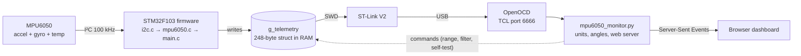
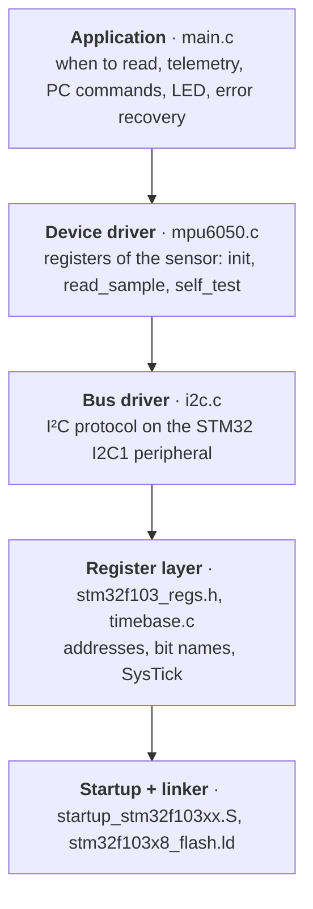
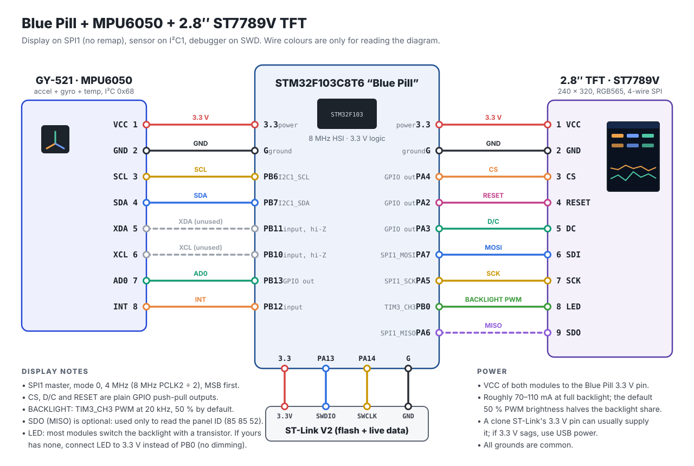
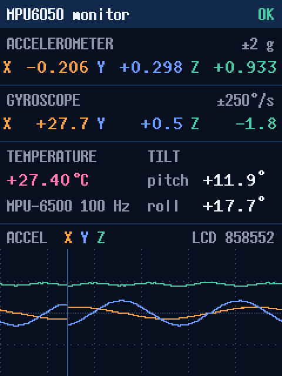

<div align="center">


# MPU6050 + STM32, bare metal

**Learn how a real sensor driver works by reading one from the first instruction after reset to a live web dashboard.**

No HAL. No CubeMX code. No UART adapter. About 1,200 lines of commented C that you can read in an evening, plus an optional live dashboard on a 2.8″ TFT.

[](#hardware)
[](#hardware)
[](Src)
[](Inc/stm32f103_regs.h)
[](tools/mpu6050_monitor.py)
[](LICENSE)

### 📖 [Read the interactive guide →](https://emersonandrey11.github.io/MPU6050-and-STM32/)


</div>

---

## Why this repo?

Most MPU6050 tutorials call `HAL_I2C_Mem_Read()` and stop there. You get numbers, but you don't learn what happens underneath.
This project shows every layer:

- 🧠 **From reset to `main()`**: the vector table, the startup assembly and the linker script, using the real addresses from the build.
- 🔧 **Registers, not libraries**: RCC, GPIO, SysTick and I2C1 are programmed directly. Each value is calculated in the guide (why `CCR = 120`, why `TRISE = 25`).
- 📡 **A robust I²C driver**: the three AN2824 read sequences, timeouts on every wait, recovery of a stuck bus, and workarounds for the STM32F1 errata.
- 🎯 **A sensor driver you can reuse**: init sequence explained write by write, 14-byte burst read, self-test, automatic MPU6500 detection.
- 🪄 **No UART needed**: the PC reads the sensor data **directly from the MCU's RAM through the ST-Link**, while the firmware keeps running, or over the board's **own micro-USB port** as a USB serial device.
- 🔌 **Bare-metal USB**: a USB device stack, a CDC serial class and a **DFU bootloader** written from the registers up, so after one install the board is powered, read and flashed through one USB cable.
- 📊 **Live dashboard**: 3-D orientation, charts, register map, and settings you can change from the browser.

## How the data gets to your screen



The firmware keeps the newest sample in one global struct. A small **sequence lock** makes sure the PC never reads a half-written sample.
The PC finds the struct by looking up its symbol in the `.elf` file.

**Or over USB:** the firmware also sends the same struct after every sample through the Blue Pill's micro-USB port, as a USB serial
device (`/dev/ttyACM0`, `COMx`), framed with a CRC-16. `mpu6050_monitor.py --usb` reads it; nothing else changes.

## Software layers



`mpu6050.c` contains **no STM32 registers**. It only calls `i2c_read()` / `i2c_write()`, so you can move it to any MCU by rewriting one file.

## A taste of the code

```c
/* Src/mpu6050.c: one burst read gives a consistent sample of all 7 values */
int mpu6050_read_sample(const mpu6050_t *dev, mpu6050_sample_t *s)
{
    uint8_t b[14];

    if (i2c_read(dev->addr, MPU_REG_ACCEL_XOUT_H, b, sizeof b) != 0) {   /* 0x3B..0x48 */
        return -1;
    }
    for (int i = 0; i < 3; i++) {
        s->accel[i] = be16(&b[2 * i]);       /* big-endian -> int16 */
        s->gyro[i]  = be16(&b[8 + 2 * i]);
    }
    s->temp = be16(&b[6]);
    return 0;
}
```

The [guide](https://emersonandrey11.github.io/MPU6050-and-STM32/#i2c-driver) explains what `i2c_read()` does underneath it, flag by flag.

## Learning path

The guide has 23 chapters and four interactive calculators (bit viewer, GPIO register calculator, raw-to-units converter, MPU register decoder).

| # | Topic | You will learn |
|---|---|---|
| 1–4 | [Big picture, wiring, files, layers](https://emersonandrey11.github.io/MPU6050-and-STM32/#overview) | how the project is organised and what a "wrapper" is for |
| 5–7 | [Startup code, linker script, build](https://emersonandrey11.github.io/MPU6050-and-STM32/#boot) | what runs before `main()`, `.data` vs `.bss`, VMA vs LMA |
| 8–10 | [Registers, RCC/GPIO, SysTick](https://emersonandrey11.github.io/MPU6050-and-STM32/#registers) | `volatile`, bit masks, CRL/CRH, a 1 ms time base |
| 11–13 | [I²C protocol and driver](https://emersonandrey11.github.io/MPU6050-and-STM32/#i2c-protocol) | START/ACK/STOP, SR1 flags, AN2824 read sequences |
| 14–16 | [The MPU6050 and its driver](https://emersonandrey11.github.io/MPU6050-and-STM32/#mpu-sensor) | scaling, filters, sample rate, init sequence, self-test |
| 17–18 | [Application and telemetry](https://emersonandrey11.github.io/MPU6050-and-STM32/#app) | super loop, sequence lock, command protocol |
| 19–20 | [Python monitor and dashboard](https://emersonandrey11.github.io/MPU6050-and-STM32/#python) | ELF parsing, OpenOCD RPC, complementary filter, SSE |
| 21 | [**Write your own driver**](https://emersonandrey11.github.io/MPU6050-and-STM32/#diy) | 8 stages from blinking an LED to a robust driver |

> Want to read it offline? Open [`docs/index.html`](docs/index.html) in your browser. It is a single file with no dependencies.

## Quick start

### Try the dashboard without any hardware

```bash
git clone https://github.com/Emersonandrey11/MPU6050-and-STM32.git
cd MPU6050-and-STM32
python3 tools/mpu6050_monitor.py --demo --web     # opens http://127.0.0.1:8000
```

### Hardware

| MPU6050 | Blue Pill | Notes |
|---|---|---|
| VCC / GND | 3.3 V / GND | |
| SCL | PB6 | I2C1, open-drain |
| SDA | PB7 | I2C1, open-drain |
| INT | PB12 | data-ready / motion interrupt |
| AD0 | PB13 | driven low → address 0x68 |
| XCL / XDA | PB10 / PB11 | left floating (aux bus unused) |

Plus an **ST-Link V2** on SWDIO, SWCLK, GND and 3.3 V. Boards sold as "GY-521" often carry an MPU6500-family chip. That's fine: the driver detects it and adapts.

### Optional: 2.8″ ST7789V TFT (240 × 320)

The firmware also draws the sensor data on a 2.8″ SPI TFT with an ST7789V controller. It works with or without the display connected.

| TFT pin | Blue Pill | Notes |
|---|---|---|
| VCC / GND | 3.3 V / GND | |
| CS | PA4 | GPIO output, active low |
| RESET | PA2 | GPIO output, active low |
| DC | PA3 | GPIO output: low = command, high = data |
| SDI (MOSI) | PA7 | SPI1_MOSI |
| SCK | PA5 | SPI1_SCK, 4 MHz, mode 0 |
| LED | PB0 | backlight PWM (TIM3_CH3, 20 kHz); brightness = `LCD_BRIGHTNESS` in `Inc/board.h`, default 50 %. Connect LED to 3.3 V instead if the module has no backlight transistor |
| SDO (MISO) | PA6 | SPI1_MISO, optional: only reads the panel ID |

<p align="center">

</p>

<p align="center">

<br><sub>The dashboard, rendered on the PC from the same <code>ui.c</code> by <code>tools/lcd_preview</code>.</sub>
</p>

If the colours look inverted, red and blue are swapped, or the picture is upside down, change `LCD_INVERT` / `LCD_MADCTL` in [`Inc/board.h`](Inc/board.h).

### Native USB: power, live data and flashing

The micro-USB connector (D− = PA11, D+ = PA12) is used by the firmware itself:

| Job | How |
|---|---|
| Power | 5 V from the PC through the on-board regulator |
| Live data | USB serial (CDC-ACM), USB ID `1209:0001`: `python3 tools/mpu6050_monitor.py --usb --web` |
| Flashing | our DFU bootloader in the first 8 KB (`1209:0002`): `./flash-usb.sh` runs `dfu-util` |

- **Once, with the ST-Link:** `./flash.sh` writes the bootloader (0x08000000) and the application (0x08002000).
- **Linux, once:** `sudo cp tools/udev/50-mpu6050-usb.rules /etc/udev/rules.d/ && sudo udevadm control --reload-rules && sudo udevadm trigger` (dfu-util without sudo, keeps ModemManager away from the port).
- **Then:** `./flash-usb.sh` builds the app, asks it to restart into the bootloader (it opens the port at 1200 baud) and flashes it. Windows: `flash-usb.ps1 -Port COM5`, after installing the WinUSB driver for the bootloader once with [Zadig](https://zadig.akeo.ie).
- **Recovery:** BOOT1 jumper to 1, press RESET: the bootloader stays in DFU mode. Put BOOT1 back to 0 afterwards.
- **Check R10 first:** USB needs a 1.5 kΩ pull-up on D+; many Blue Pills ship with 10 kΩ or 4.7 kΩ, which can stop the PC from detecting the board.
- Breakpoint debugging still needs the ST-Link (SWD).
- `1209:0001`/`0002` are [pid.codes](https://pid.codes) *test* IDs: fine on your bench, not for boards you give away.

USB needs an exact 48 MHz clock, so the chip now runs from the 8 MHz crystal × 6 = **48 MHz** (`Src/clock.c`).
`tools/usb_sim/run.sh` runs the USB code on the PC against a model of the peripheral (enumeration, USB serial, a full DFU update).

### Build, flash, run

```bash
# Linux (toolchain from the STM32Cube VS Code extension, see INSTALL.md)
sudo apt install openocd stlink-tools python3
./flash.sh                                   # CMake + Ninja build, then flash bootloader + app over ST-Link
python3 tools/mpu6050_monitor.py --web       # keep the sensor still for 2 s (gyro calibration)
./flash-usb.sh                               # later: flash the app over the board's own USB port
python3 tools/mpu6050_monitor.py --usb --web # live data over USB instead of the ST-Link
```

On Windows: `powershell -ExecutionPolicy Bypass -File .\flash.ps1`. The full step-by-step setup is in [INSTALL.md](INSTALL.md).

LED on PC13: **slow blink** = sensor OK, **fast blink** = sensor not answering on I²C (the firmware retries every second), **double blink** = USB bootloader (DFU mode).

Monitor options: `--usb [PORT]` (native USB instead of the ST-Link), `--csv` (one CSV line per sample), `--probe` (raw OpenOCD diagnostics), `--halt-reads`, `--poll-hz N`.

## Repository layout

```
Inc/                    headers: board.h (pins), stm32f103_regs.h (registers), i2c.h, mpu6050.h, telemetry.h,
                        spi.h, st7789.h, gfx.h, font.h, ui.h (TFT), clock.h, usb.h, usb_cdc.h, usb_ids.h (USB)
Src/                    startup_stm32f103xx.S, main.c, i2c.c, mpu6050.c, timebase.c, clock.c (48 MHz),
                        spi.c, st7789.c, gfx.c, font_data.c, ui.c (TFT), usb.c, usb_cdc.c (USB)
bootloader/             USB DFU bootloader (8 KB at 0x08000000) + bootloader.ld
stm32f103x8_flash.ld    application linker script (56 KB from 0x08002000, 20 KB RAM)
tools/                  mpu6050_monitor.py (PC side) + dashboard.html, gen_font.py,
                        lcd_preview/ (renders the TFT screen on the PC), usb_sim/ (USB tests on the PC),
                        udev/ (Linux rule for the USB IDs)
docs/index.html         the interactive study guide (GitHub Pages)
CMakeLists.txt, cmake/  build system
flash.sh, flash.ps1     build + flash bootloader + app with the ST-Link
flash-usb.sh, .ps1      build + flash the app over USB (dfu-util)
```

## Key numbers

| | |
|---|---|
| CPU clock | 48 MHz: 8 MHz crystal × 6 (USB needs exactly 48 MHz) |
| I²C | 100 kHz, polling |
| Sample rate | 100 Hz (`1 kHz / (1 + 9)`) |
| Ranges | ±2 g, ±250 °/s (changeable from the dashboard) |
| Flash / RAM | app ≈ 28.9 KB of 56 KB / ≈ 3.7 KB (Debug build, `-O0`); bootloader ≈ 4 KB of 8 KB |
| TFT | SPI1 at 12 MHz; only changed characters are redrawn, ≤ 0.5 ms of SPI per main-loop pass |
| USB | full speed, CDC serial: one 250-byte frame per sample (25 KB/s); DFU: 1 KB blocks |

## Exercises and ideas

Fork the repo and try one. Pull requests that add explanations to the guide are welcome.

- Move the INT handling into an `EXTI15_10_IRQHandler` interrupt.
- Change `SystemInit()` to run at 72 MHz instead of 48 (USB prescaler ÷ 1.5), then switch I²C to 400 kHz fast mode.
- Use the MPU6050 FIFO to read many samples per transaction.
- Run the complementary filter on the MCU with fixed-point maths (the Cortex-M3 has no FPU).
- Port `i2c.c` to another MCU and keep `mpu6050.c` unchanged.
- Send the TFT pixels with DMA (DMA1 channel 3 serves SPI1_TX) so the CPU is free while a glyph is sent.

See [CONTRIBUTING.md](CONTRIBUTING.md).

## References

- RM0008: STM32F101/102/103 reference manual · PM0056: Cortex-M3 programming manual
- MPU-6000/6050 Register Map (RM-MPU-6000A rev 4.2) and Product Specification
- AN2824: STM32F10xxx I²C optimized examples · ES096: STM32F10xx8 errata

## License

[MIT](LICENSE) for the project code. The files supplied by STMicroelectronics (the startup file, the syscall/sysmem stubs and the linker script) keep their original terms.

<div align="center">

**If this helped you understand embedded systems a bit better, please give it a ⭐ so other learners can find it.**

</div>
