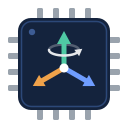
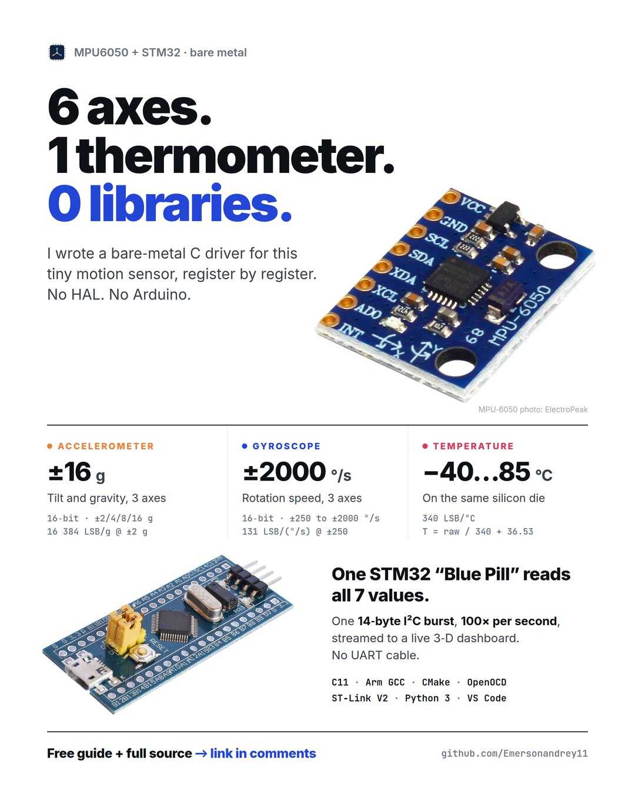
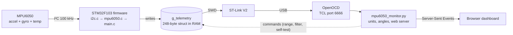
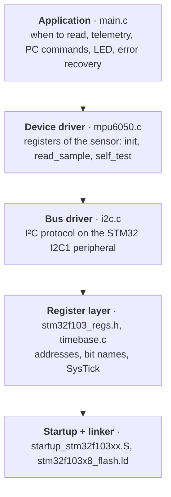

<div align="center">



# MPU6050 + STM32, bare metal

**Learn how a real sensor driver works by reading one from the first instruction after reset to a live web dashboard.**

No HAL. No CubeMX code. No UART adapter. About 1,200 lines of commented C that you can read in an evening.

[](#hardware)
[](#hardware)
[](Src)
[](Inc/stm32f103_regs.h)
[](tools/mpu6050_monitor.py)
[](LICENSE)

### 📖 [Read the interactive guide →](https://emersonandrey11.github.io/MPU6050-and-STM32/)



</div>

---

## Why this repo?

Most MPU6050 tutorials call `HAL_I2C_Mem_Read()` and stop there. You get numbers, but you don't learn what happens underneath.
This project shows every layer:

- 🧠 **From reset to `main()`**: the vector table, the startup assembly and the linker script, using the real addresses from the build.
- 🔧 **Registers, not libraries**: RCC, GPIO, SysTick and I2C1 are programmed directly. Each value is calculated in the guide (why `CCR = 40`, why `TRISE = 9`).
- 📡 **A robust I²C driver**: the three AN2824 read sequences, timeouts on every wait, recovery of a stuck bus, and workarounds for the STM32F1 errata.
- 🎯 **A sensor driver you can reuse**: init sequence explained write by write, 14-byte burst read, self-test, automatic MPU6500 detection.
- 🪄 **No UART needed**: the PC reads the sensor data **directly from the MCU's RAM through the ST-Link**, while the firmware keeps running.
- 📊 **Live dashboard**: 3-D orientation, charts, register map, and settings you can change from the browser.

## How the data gets to your screen



The firmware keeps the newest sample in one global struct. A small **sequence lock** makes sure the PC never reads a half-written sample.
The PC finds the struct by looking up its symbol in the `.elf` file.

## Software layers



`mpu6050.c` contains **no STM32 registers**. It only calls `i2c_read()` / `i2c_write()`, so you can move it to any MCU by rewriting one file.

## A taste of the code

```c
/* Src/mpu6050.c: one burst read gives a consistent sample of all 7 values */
int mpu6050_read_sample(const mpu6050_t *dev, mpu6050_sample_t *s)
{
    uint8_t b[14];

    if (i2c_read(dev->addr, MPU_REG_ACCEL_XOUT_H, b, sizeof b) != 0) {   /* 0x3B..0x48 */
        return -1;
    }
    for (int i = 0; i < 3; i++) {
        s->accel[i] = be16(&b[2 * i]);       /* big-endian -> int16 */
        s->gyro[i]  = be16(&b[8 + 2 * i]);
    }
    s->temp = be16(&b[6]);
    return 0;
}
```

The [guide](https://emersonandrey11.github.io/MPU6050-and-STM32/#i2c-driver) explains what `i2c_read()` does underneath it, flag by flag.

## Learning path

The guide has 23 chapters and four interactive calculators (bit viewer, GPIO register calculator, raw-to-units converter, MPU register decoder).

| # | Topic | You will learn |
|---|---|---|
| 1–4 | [Big picture, wiring, files, layers](https://emersonandrey11.github.io/MPU6050-and-STM32/#overview) | how the project is organised and what a "wrapper" is for |
| 5–7 | [Startup code, linker script, build](https://emersonandrey11.github.io/MPU6050-and-STM32/#boot) | what runs before `main()`, `.data` vs `.bss`, VMA vs LMA |
| 8–10 | [Registers, RCC/GPIO, SysTick](https://emersonandrey11.github.io/MPU6050-and-STM32/#registers) | `volatile`, bit masks, CRL/CRH, a 1 ms time base |
| 11–13 | [I²C protocol and driver](https://emersonandrey11.github.io/MPU6050-and-STM32/#i2c-protocol) | START/ACK/STOP, SR1 flags, AN2824 read sequences |
| 14–16 | [The MPU6050 and its driver](https://emersonandrey11.github.io/MPU6050-and-STM32/#mpu-sensor) | scaling, filters, sample rate, init sequence, self-test |
| 17–18 | [Application and telemetry](https://emersonandrey11.github.io/MPU6050-and-STM32/#app) | super loop, sequence lock, command protocol |
| 19–20 | [Python monitor and dashboard](https://emersonandrey11.github.io/MPU6050-and-STM32/#python) | ELF parsing, OpenOCD RPC, complementary filter, SSE |
| 21 | [**Write your own driver**](https://emersonandrey11.github.io/MPU6050-and-STM32/#diy) | 8 stages from blinking an LED to a robust driver |

> Want to read it offline? Open [`docs/index.html`](docs/index.html) in your browser. It is a single file with no dependencies.

## Quick start

### Try the dashboard without any hardware

```bash
git clone https://github.com/Emersonandrey11/MPU6050-and-STM32.git
cd MPU6050-and-STM32
python3 tools/mpu6050_monitor.py --demo --web     # opens http://127.0.0.1:8000
```

### Hardware

| MPU6050 | Blue Pill | Notes |
|---|---|---|
| VCC / GND | 3.3 V / GND | |
| SCL | PB6 | I2C1, open-drain |
| SDA | PB7 | I2C1, open-drain |
| INT | PB12 | data-ready / motion interrupt |
| AD0 | PB13 | driven low → address 0x68 |
| XCL / XDA | PB10 / PB11 | left floating (aux bus unused) |

Plus an **ST-Link V2** on SWDIO, SWCLK, GND and 3.3 V. Boards sold as "GY-521" often carry an MPU6500-family chip. That's fine: the driver detects it and adapts.

### Build, flash, run

```bash
# Linux (toolchain from the STM32Cube VS Code extension, see INSTALL.md)
sudo apt install openocd stlink-tools python3
./flash.sh                                   # CMake + Ninja build, then flash over ST-Link
python3 tools/mpu6050_monitor.py --web       # keep the sensor still for 2 s (gyro calibration)
```

On Windows: `powershell -ExecutionPolicy Bypass -File .\flash.ps1`. The full step-by-step setup is in [INSTALL.md](INSTALL.md).

LED on PC13: **slow blink** = sensor OK, **fast blink** = sensor not answering on I²C (the firmware retries every second).

Monitor options: `--csv` (one CSV line per sample), `--probe` (raw OpenOCD diagnostics), `--halt-reads`, `--poll-hz N`.

## Repository layout

```
Inc/                    headers: board.h (pins), stm32f103_regs.h (registers), i2c.h, mpu6050.h, telemetry.h
Src/                    startup_stm32f103xx.S, main.c, i2c.c, mpu6050.c, timebase.c
stm32f103x8_flash.ld    linker script (64 KB flash, 20 KB RAM)
tools/                  mpu6050_monitor.py (PC side) + dashboard.html
docs/index.html         the interactive study guide (GitHub Pages)
CMakeLists.txt, cmake/  build system
flash.sh, flash.ps1     build + flash scripts
```

## Key numbers

| | |
|---|---|
| CPU clock | 8 MHz internal HSI (no PLL) |
| I²C | 100 kHz, polling |
| Sample rate | 100 Hz (`1 kHz / (1 + 9)`) |
| Ranges | ±2 g, ±250 °/s (changeable from the dashboard) |
| Flash / RAM | ≈ 6.4 KB / ≈ 0.9 KB (Debug build, `-O0`) |

## Exercises and ideas

Fork the repo and try one. Pull requests that add explanations to the guide are welcome.

- Move the INT handling into an `EXTI15_10_IRQHandler` interrupt.
- Write your own `SystemInit()` to run at 72 MHz, then switch I²C to 400 kHz fast mode.
- Use the MPU6050 FIFO to read many samples per transaction.
- Run the complementary filter on the MCU with fixed-point maths (the Cortex-M3 has no FPU).
- Port `i2c.c` to another MCU and keep `mpu6050.c` unchanged.

See [CONTRIBUTING.md](CONTRIBUTING.md).

## References

- RM0008: STM32F101/102/103 reference manual · PM0056: Cortex-M3 programming manual
- MPU-6000/6050 Register Map (RM-MPU-6000A rev 4.2) and Product Specification
- AN2824: STM32F10xxx I²C optimized examples · ES096: STM32F10xx8 errata

## License

[MIT](LICENSE) for the project code. The files supplied by STMicroelectronics (the startup file, the syscall/sysmem stubs and the linker script) keep their original terms.

<div align="center">

**If this helped you understand embedded systems a bit better, please give it a ⭐ so other learners can find it.**

</div>
